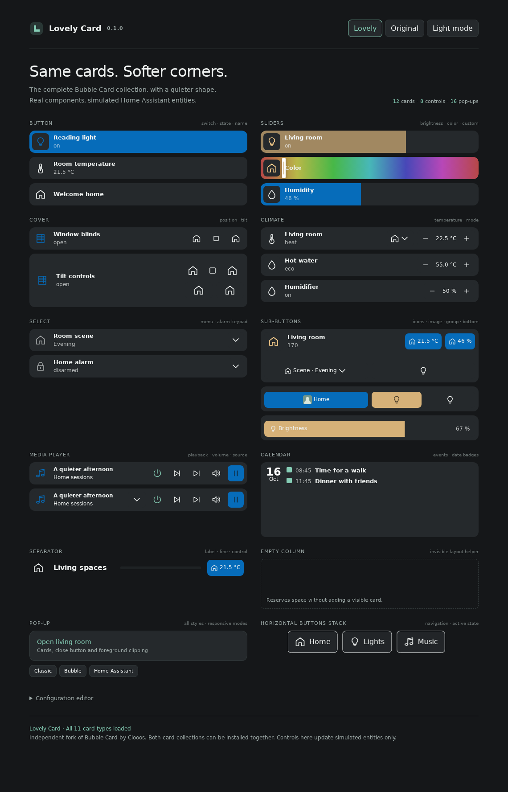

<p align="center"></p>

# Lovely Card

Bubble Card's controls and features, with softly rounded rectangles in place of pills and circles. An independent Home Assistant card collection forked from [Clooos/Bubble-Card v3.4.2](https://github.com/Clooos/Bubble-Card/releases/tag/v3.4.2), ready to grow with your own card types.

Lovely Card installs independently and can coexist with Bubble Card. It uses `custom:lovely-card`, its own editor, resource file, browser events, and local caches. Existing `custom:bubble-card` cards continue using the original. Use distinct pop-up hashes when using both collections on one dashboard.



## Install

The built card is included in this repository. Install it directly into Home Assistant using either method below; building the source is only needed for development.

### HACS (recommended)

With [HACS installed and configured](https://www.hacs.dev/docs/use/), open this fork in your Home Assistant:

[](https://my.home-assistant.io/redirect/hacs_repository/?owner=valentinpurrucker&repository=lovely-card&category=plugin)

1. Follow the link above and add the repository when prompted. Alternatively, in **HACS → ⋮ → Custom repositories**, enter `https://github.com/valentinpurrucker/lovely-card`, select **Dashboard**, and select **Add**.
2. Open **Lovely Card** in HACS and select **Download**. Until the fork has a release, install the **main** branch; its `dist/` directory contains the ready-to-use card and translations. HACS supports installing directly from the default branch.
3. Check the [dashboard resources](https://my.home-assistant.io/redirect/lovelace_resources/) for the HACS URL in the table below. If HACS has not added it, add it as a **JavaScript module**.
4. Reload Home Assistant in your browser or Companion App, then [add a card](#add-a-card).

See the [HACS custom repository instructions](https://www.hacs.dev/docs/faq/custom_repositories/) and [default-branch installation support](https://www.hacs.dev/docs/publish/plugin/#if-there-are-no-releases) for more detail.

### Manual installation

1. [Download the repository ZIP](https://github.com/valentinpurrucker/lovely-card/archive/refs/heads/main.zip), extract it, and copy the **contents of `dist/`** into `/config/www/lovely-card/`. The result must include `/config/www/lovely-card/lovely-card.js` and the neighboring `lovely-card-<language>.json` files. English is bundled; keep the JSON files for a translated editor. For English only, you can instead [download just `lovely-card.js`](https://raw.githubusercontent.com/valentinpurrucker/lovely-card/main/dist/lovely-card.js).
2. If you created the `/config/www/` directory for the first time, restart Home Assistant so it can serve `/local/` files.
3. Open [dashboard resources](https://my.home-assistant.io/redirect/lovelace_resources/) (**Settings → Dashboards → ⋮ → Resources**) and add the manual URL below as a **JavaScript module**. Enable **Advanced mode** in your user profile if Resources is hidden.
4. Reload Home Assistant in your browser or Companion App, then [add a card](#add-a-card).

### Resource URLs

Register **one** Lovely Card resource, using the URL for your installation method:

| Installation | Resource URL | Type |
| --- | --- | --- |
| HACS | `/hacsfiles/lovely-card/lovely-card.js` | JavaScript module |
| Manual | `/local/lovely-card/lovely-card.js?v=0.1.0` | JavaScript module |

Keep any cache parameter HACS adds to its resource URL. Bubble Card's existing resource can stay registered alongside Lovely Card.

If you already manage resources in YAML, merge this into the existing `lovelace:` section of **`configuration.yaml`**, using the URL from the table for your installation method:

```yaml
lovelace:
  resource_mode: yaml
  resources:
    - url: /hacsfiles/lovely-card/lovely-card.js
      type: module
```

Reload dashboard resources after editing the YAML, then refresh the browser. See Home Assistant's [resource registration](https://developers.home-assistant.io/docs/frontend/custom-ui/registering-resources/) and [YAML resource configuration](https://www.home-assistant.io/dashboards/dashboards/#adding-yaml-dashboards) documentation.

### Add a card

Edit a dashboard, select **Add card**, and search for **Lovely Card**. You can also select **Manual** and paste this YAML, replacing the entity with one from your Home Assistant:

```yaml
type: custom:lovely-card
card_type: button
button_type: slider
entity: light.living_room
name: Living room
icon: mdi:lightbulb-outline
```

To copy an existing Bubble Card, change `type: custom:bubble-card` to `type: custom:lovely-card`. Keep the other options. Change nested card types too if you want Lovely styling inside pop-ups; other Home Assistant cards retain their own appearance.

### Updates and troubleshooting

For HACS installs, use HACS to update or **Redownload** the card; select **main** to follow this fork's development branch. For manual installs, replace the files in `/config/www/lovely-card/` and change the resource's `?v=` value to a new value so browsers fetch the updated file. Refresh each browser or Companion App afterward.

If Home Assistant reports **Custom element doesn't exist: lovely-card**, check that the matching resource URL above opens a JavaScript file on your Home Assistant instance, that its resource type is **JavaScript module**, and that you use `type: custom:lovely-card`. Clear the frontend cache if a refresh still shows the old version.

## The corner system

All corner sizes are defined in **[`src/styles/corners.js`](src/styles/corners.js)**. Change `cornerScale` to resize the whole collection proportionally, or edit one entry in `cornerSizes` to change a role such as cards or controls. Run `npm run dist` afterward. Components have no numeric corner fallbacks of their own; editor panels, detached pop-ups, hold indicators, and onboarding illustrations use the same configuration.

Every bundled card type is retained: **button** (switch, slider, state, name), **sub-buttons**, **separator**, **cover**, **climate** (including water heaters and humidifiers), **select**, **media player**, **calendar**, **horizontal buttons stack**, **pop-up**, and **empty column**. Empty columns remain invisible layout helpers.

The design also covers nested and bottom sub-buttons, grouped controls, sliders and color cursors, dropdown menus, alarm keypads, entity pictures, media/volume controls, pop-up navigation and close buttons, foreground clipping, all responsive pop-up modes and styles, onboarding illustrations, the configuration editor, and Module Store UI.

| Theme variable | Default | Use |
| --- | --- | --- |
| `lovely-radius-card` | `12px` | Cards, calendar events, editor panels |
| `lovely-radius-control` | `8px` | Buttons, menus, sliders, chips |
| `lovely-radius-icon` | `8px` | Main icon and entity-picture containers |
| `lovely-radius-popup` | `16px` | Dialogs and bottom sheets |
| `lovely-radius-small` | `4px` | Small images and compact badges |
| `lovely-radius-indicator` | `2px` | Color cursors, keypad indicators, separator lines |
| `lovely-radius-editor` | `6px` | Small editor panels and examples |
| `lovely-radius-tab` | `3px` | Module tab accents |
| `lovely-radius-handle` | `1px` | Thin pop-up handles and decorative strokes |

Set these keys in a Home Assistant theme (Home Assistant adds the CSS `--` prefix):

```yaml
My theme:
  lovely-radius-card: 12px
  lovely-radius-control: 8px
  lovely-radius-icon: 8px
  lovely-radius-popup: 16px
```

`lovely-radius` optionally sets a single fallback for the entire collection. Individual Lovely tokens take precedence over it. Existing `--bubble-…-border-radius` variables and custom styles are still supported and take precedence over Lovely defaults. If a copied card or theme explicitly sets a pill/circle radius, remove that override to see the new defaults. Lovely Card does not set radius variables on the document or alter the original Bubble Card's styling.

Colors, spacing, layouts, entity handling, actions, templates, translations, and the module system remain based on upstream. Community modules can supply their own styling; use the Lovely tokens in new modules to follow this design.

## Develop and add your own cards

See [the developer guide](DEVELOPERS.md) for builds, the local component gallery, browser checks, and the steps to add a card type. The [upstream configuration reference](UPSTREAM.md) still applies; substitute `custom:lovely-card` and the Lovely resource filename in its examples. [Module development](src/modules/module-documentation.md) is also available.

```bash
npm ci
npm test -- --runInBand --forceExit
npm run dist
npm run preview
```

## Credits and license

Lovely Card is an independent fork, not an official Bubble Card release. Bubble Card was created by **Clooos** and its contributors. The original [MIT license](LICENSE), source history, and [upstream README](UPSTREAM.md) are preserved. Please report fork-specific issues [here](https://github.com/valentinpurrucker/lovely-card/issues).
